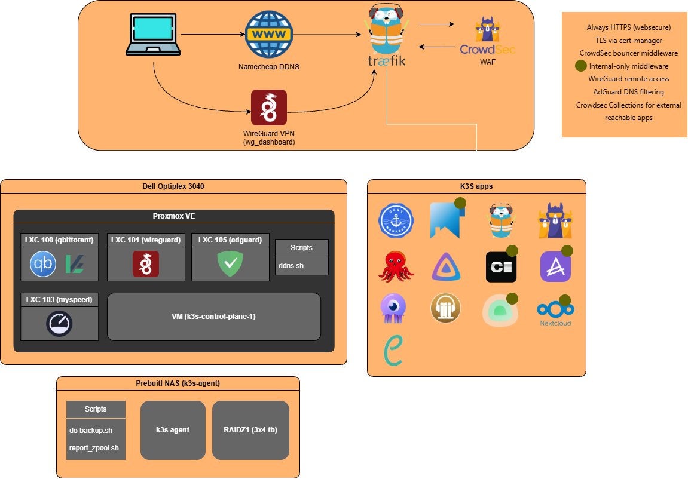

# Homelab Infrastructure

## Network Diagram

## Node Workload Distribution

### Computer 1: Dell OptiPlex 3040 SFF
- **Proxmox VE Host**: Runs `scripts/ddns.sh` for Namecheap dynamic DNS updates.
- **LXC Containers**:
  - `AdGuard Home`: DNS server (`dns.lan`).
  - `qBittorrent`: Download client.
  - `WireGuard`: Remote VPN gateway.
  - `MySpeed`: Speed test monitor (`speed.lan`).
- **Virtual Machine**:
  - K3s node participating in the Kubernetes cluster.

### Computer 2: Self-Built NAS & K3s Node
- **Hardware Specs**:
  - CPU: Intel Core i3-14100 (4C/8T, Intel UHD Graphics 730)
  - Memory: 32 GB RAM
  - Boot Drive: 1TB Kingston SNV3S1000G NVMe SSD
  - Storage: 3x 4TB Western Digital Red Plus (WD40EFPX)
- **Host OS & Non-Containerized Services**:
  - **ZFS Pool**: Manages the 3x 4TB drives; monitored by `scripts/report_zpool.sh` with email/ntfy alerts.
  - **NFS Server**: Serves `${NFS_PATH}` to the cluster for `nfs-subdir-external-provisioner` (`nfs-vault` storage class).
  - **Glances**: System resource monitor on port `61208` (fed into GetHomepage).
  - **Backup Engine**: `scripts/do-backup.sh` synchronizes encrypted data to cloud storage via `rclone crypt` (supports `.backup-ignore` and `-D` dry runs).

#### Workloads Pinned to NAS Node (`homelab.lan/nfs-node: "true"`)
These workloads are pinned via `nodeAffinity` for direct host storage access or hardware transcoding:

| Workload | Why It Runs on the NAS Node |
| :--- | :--- |
| **Jellyfin** | Utilizes the Intel i3-14100 UHD 730 iGPU for hardware transcoding via `gpu.intel.com/i915: "1"` (Intel Device Plugin Operator) and mounts `hostPath: ${NFS_PATH}/media` directly without NFS network overhead. |
| **Calibre-Web** | Mounts `hostPath: ${NFS_PATH}/books/ebooks/calibre_web` directly at `/mnt/books`. |
| **Nextcloud** | Mounts `${NFS_PATH}` directly into the container via `hostPath`. |
| **Audiobookshelf** | Low-latency local access for library and backup storage. |
| **Jellyseerr** | Placed adjacent to Jellyfin and the media pool. |
| **Uptime Kuma** | Infrastructure uptime monitoring. |

